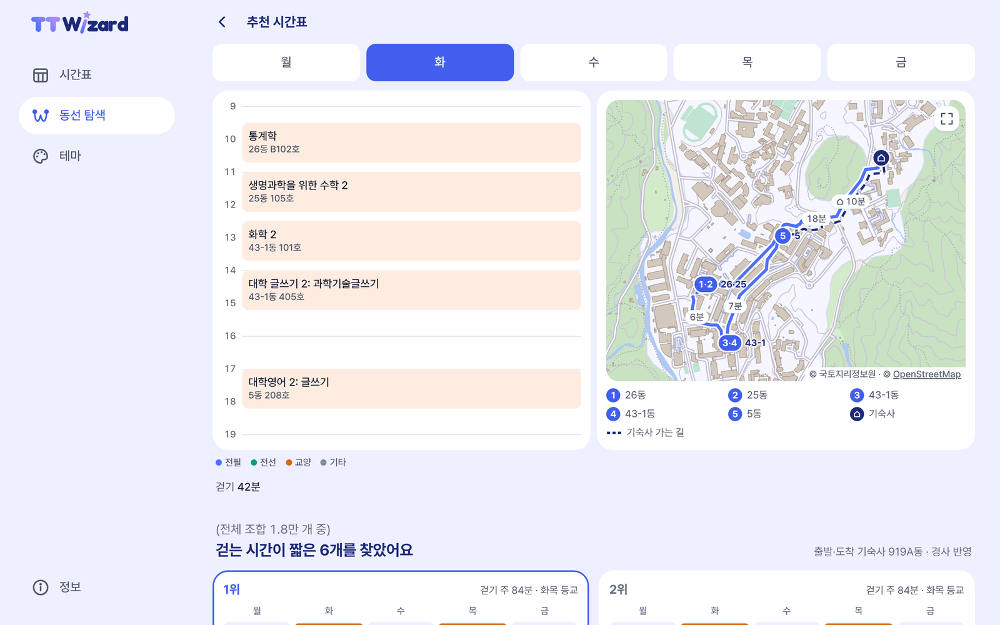
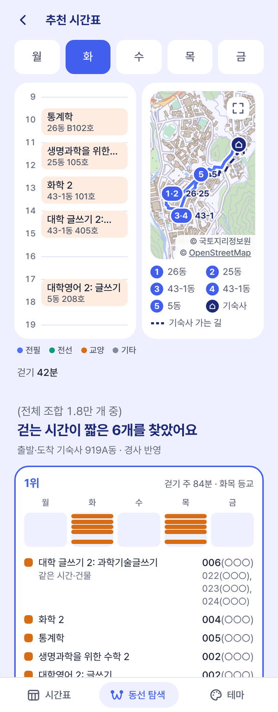
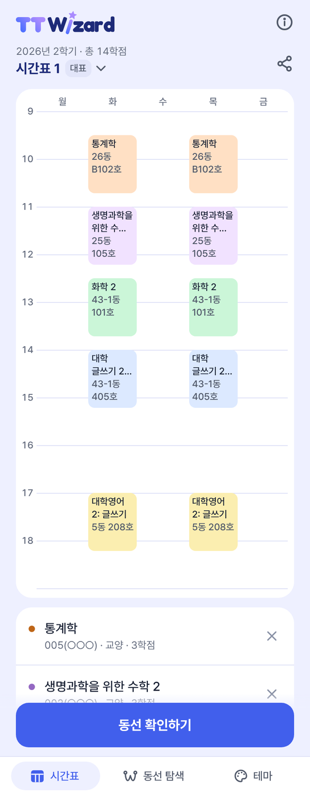
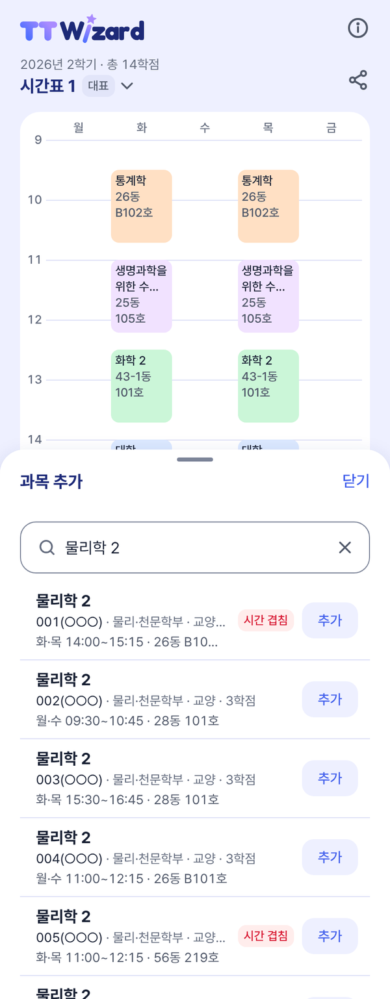
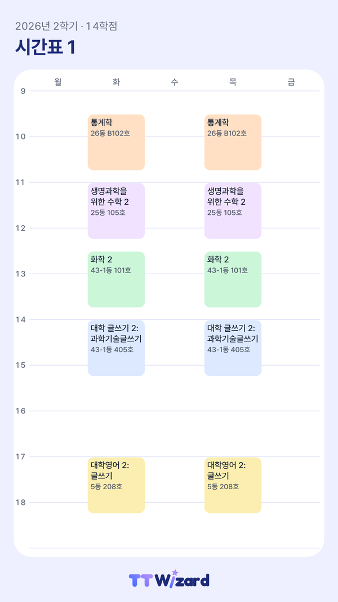
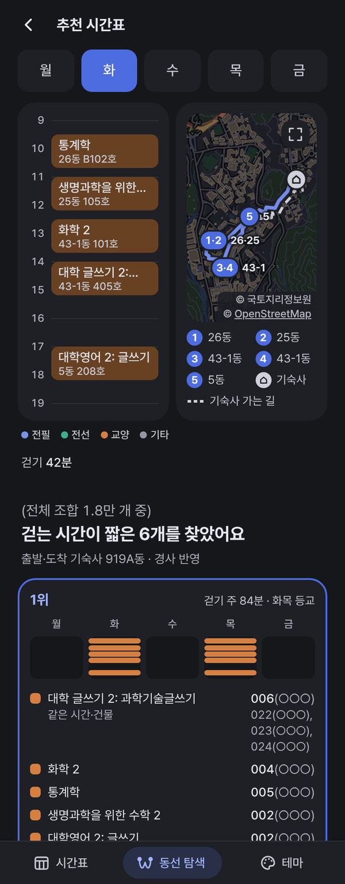

<h1 align="center">
  <picture>
    <source media="(prefers-color-scheme: dark)" srcset="web/icons/wordmark-dark.svg">
    
  </picture>
</h1>

<p align="center">
  가장 가까운 한 주<br>
  <a href="https://archi142857.github.io/tt-wizard/"><b>웹에서 바로 쓰기</b></a>
</p>

<p align="center">
  
</p>

서울대학교 관악캠퍼스에서 들을 과목을 담으면, 분반마다 다른 시간과 강의실을 모두 견줘서 일주일 동안 강의실 사이를 걷는 시간이 가장 짧은 분반 조합을 찾아 주는 시간표 앱입니다.

같은 과목이라도 분반마다 강의실이 다른 경우가 많습니다. 2026년 2학기 학부 과목 가운데 분반이 둘 이상이고 강의 건물이 나와 있는 과목을 보면, 절반이 넘는 54%는 분반들이 서로 다른 건물에 흩어져 있습니다. 관악캠퍼스는 넓은 데다 언덕이 많아서, 분반을 어떻게 고르느냐에 따라 한 학기 동안 걷는 시간이 꽤 달라집니다.

서울대학교 공식 서비스가 아닙니다. 학생 개인이 만든 앱입니다.

## 쓰는 법

1. `동선 탐색` 탭에서 학기를 고르고 들을 과목을 검색해 담습니다.
2. 하루를 시작할 곳과 필요한 조건을 정하고 `시간표 만들기`를 누릅니다.
3. 후보를 눌러 요일마다 동선을 보고, 마음에 들면 `저장하기`를 누릅니다. 저장한 시간표는 `시간표` 탭에 모입니다.

## 할 수 있는 것

### 동선 탐색

<p align="center">
  
  &nbsp;
  
</p>

- 들을 과목을 담으면 시간이 겹치지 않는 분반 조합을 모두 따져서, 한 주 동안 걷는 시간이 짧고 늦는 일이 적은 순서로 보여 줍니다.
- 요일마다 수업 순서대로 걷는 길을 지도에 그리고 구간마다 몇 분 걷는지 적어 줍니다. 쉬는 시간 안에 가기 빠듯한 수업은 몇 분 늦는지도 알려 주고, 지도는 크게 펼쳐 볼 수 있습니다.
- 후보마다 한 주에 걷는 시간과 학교 가는 요일, 늦는 수업이 한 줄로 나옵니다. 마음에 드는 후보는 바로 저장합니다.
- 하루를 시작하고 끝낼 곳(정문, 기숙사 동, 다른 건물)을 고르고, 오르막을 반영할지 평지로 볼지 정합니다.
- `추가 설정`에서 공강 요일과 점심시간을 정하면 그 조건을 지키는 조합만 찾습니다. 맞는 조합이 없으면 왜 없는지와 걸리는 과목을 알려 줍니다.
- 과목마다 들을 분반만 켜 둘 수 있고, 강의실이나 시간이 아직 안 나왔거나 바뀐 분반은 직접 넣거나 고칩니다. 넣지 않은 수업은 걷는 시간 계산에서 빠집니다.

### 시간표

<p align="center">
  
  &nbsp;
  
  &nbsp;
  
</p>

- 저장한 조합은 `시간표` 탭에 모입니다. 학기마다 시간표를 여러 개 만들고, 복사하고, 이름을 바꾸고, 대표 시간표를 정합니다.
- `과목 추가`로 과목을 찾아 분반을 바로 넣습니다. 겹치는 분반은 미리 `시간 겹침`으로 보여 주고, 그래도 넣으면 겹친 과목을 빼고 넣은 뒤 되돌릴 수 있게 해 줍니다.
- `직접 추가`로 동아리나 아르바이트 같은 개인 일정도 장소와 함께 넣습니다.
- `동선 확인하기`를 누르면 그 시간표의 요일별 동선을 `동선 탐색`에서 바로 봅니다. 다른 분반을 켜서 더 가까운 조합이 있는지 찾아볼 수도 있습니다.
- 시간표를 이미지로 저장하거나 링크로 보냅니다. 이미지 파일 안에 시간표 정보가 같이 들어 있어서 `이미지로 추가`로 같은 시간표를 그대로 불러올 수 있습니다(메모는 뺍니다). 메신저에서 사진으로 보내면 다시 압축되면서 이 정보가 빠지므로 파일로 주고받아야 합니다.
- 받은 링크를 열면 그 시간표를 미리 보고 내 시간표에 넣습니다.
- 저장한 뒤 편람에서 강의 시간이나 강의실이 바뀌거나, 과목이 없어지거나, 폐강 대상이 되면 표시해 줍니다.
- 칸 색은 과목마다 다르게 하거나 교과구분별로 맞출 수 있습니다.

### 테마와 그 밖에

<p align="center">
  
  &nbsp;
  
</p>

- 테마는 기기 설정, 라이트, 다크 가운데 고릅니다. 12월 한 달은 크리스마스 테마가 켜지고, 원하면 바로 되돌립니다.
- 과목명, 교과목번호, 교수 이름으로 찾습니다. 줄임말(`대글`), 초성 섞어 쓰기(`ㄷㅎ글쓰기`), 한/영 전환을 잊고 친 글자(`eogkr`)도 알아듣습니다. 태블릿이나 컴퓨터에서는 교양이나 학과별 과목 목록을 둘러볼 수도 있습니다.
- 2021년 1학기부터 지난 학기 편람도 골라 볼 수 있습니다.
- 과목 화면에서 강의평 검색과 수강편람 사이트를 바로 엽니다.
- 가입이 필요 없습니다. 담은 과목과 시간표는 기기에만 저장되고, 한 번 열어 두면 인터넷이 끊겨도 그대로 씁니다.
- 폰 홈 화면에 추가하면 앱처럼 씁니다. 컴퓨터에서는 맨 위 그림처럼 왼쪽 메뉴와 넓은 화면으로 보입니다.
- 글자 크기를 키워도 화면이 맞춰지고, 스크린리더로도 쓸 수 있게 만들었습니다.

화면 캡처는 2026년 2학기 편람으로 찍었고, 교수 이름은 ○○○로 가렸습니다.

## 걷는 시간은 이렇게 계산합니다

걷는 시간은 [캠퍼스 마법 지도](https://moreadorecampus.com/)의 도로 그래프 위에서 건물 출입구 사이 길을 찾아 계산합니다. 받은 그래프에서 끊긴 갈림목은 잇고, 빠진 보도와 계단, 출입구는 더하고, 건물을 뚫고 지나가는 길은 막았습니다.

평지는 초속 1.1m로 걷는다고 봅니다. 경사는 30m 구간마다 재서 Tobler 보행 함수로, 계단은 계단 보행 실측(Fujiyama & Tyler, 2004)에 맞춘 식으로 계산합니다. 그래서 같은 두 건물 사이도 올라갈 때와 내려올 때 시간이 다르고, 방향마다 더 빠른 길을 고릅니다. 길마다 경사가 어떤지는 [관악캠퍼스 3D 모형](https://archi142857.github.io/tt-wizard/model/campus-3d.html)에서 볼 수 있습니다.

조합은 과목마다 분반을 하나씩 고르는 문제로 풉니다. 시간이 겹치는 조합은 빼고, 나머지는 한 주 동안 걷는 시간에 늦는 시간의 두 배를 더한 값으로 줄을 세웁니다. 찾을 때는 백트래킹과 분기 한정으로 가망 없는 가지를 미리 쳐 냅니다.

모두 추정값이라 실제로 걸리는 시간과 다를 수 있습니다. 방법과 한계는 [docs/travel_time_method.md](docs/travel_time_method.md)에 정리해 두었습니다.

## 얼마나 줄어드는지

2026년 2학기 편람으로 학과와 학년마다 들을 법한 과목을 대여섯 개씩 묶은 가상 과목 묶음 1,000개를 만들고, 시간만 겹치지 않게 분반을 아무렇게나 고른 경우와 견주어 보았습니다.

기숙사(919A동)에서 출발하면 이 앱이 고른 1순위 조합이 한 주에 평균 14.8분 덜 걷는 것으로 계산되었습니다(95% 신뢰구간 13.9–15.7분). 한 학기(15주)로 치면 3.7시간쯤입니다. 묶음의 82%는 분반을 어떻게 고르느냐에 따라 걷는 시간이나 늦는 시간이 달라졌습니다.

결과는 [results/experiments](results/experiments/README.md), 방법은 [docs/experiments.md](docs/experiments.md)에 있습니다.

## 직접 돌려 보기

```
pip install -r requirements.txt
python -m pytest -q                  # 테스트
python -m ttwizard demo              # 가짜 강좌로 한번 돌려 보기
python scripts/export_web.py         # data/ → web/data/*.json
python -m http.server 8000 -d web    # http://localhost:8000 에서 웹 앱
```

웹 앱은 서버 없이 정적 파일로만 돌아갑니다(GitHub Pages). 탐색 엔진을 자바스크립트로 옮긴 `web/js/engine.js`가 브라우저 안에서 조합을 찾고, 파이썬 엔진과 같은 답을 내는지는 테스트로 확인합니다. 화면 쪽 자세한 내용은 [web/README.md](web/README.md)에 있습니다.

<details>
<summary>실제 편람으로 명령줄에서 찾기</summary>

```
python -m ttwizard parse data/raw/latest.xls -o data/lectures.json
python scripts/fetch_buildings.py
python scripts/slope_travel.py
python -m ttwizard find --lectures data/lectures.json 생화학
python -m ttwizard search --lectures data/lectures.json --courses F11.101,4190.308,F32.102 --home 919A --top 5 --travel data/travel_slope.csv --json data/results.json
```

1. 수강편람 엑셀을 `lectures.json`으로 바꿉니다. 엑셀은 sugang.snu.ac.kr 강좌검색에서 저장하거나 `scripts/sync.py`로 받습니다.
2. 캠퍼스맵에서 건물 좌표를 받아 `data/buildings.csv`를 만듭니다.
3. 이동시간 행렬을 만듭니다. 평지는 `data/travel.csv`, 경사를 반영한 것은 `data/travel_slope.csv`입니다.
4. 과목을 찾고 탐색합니다. `--home`은 출발·도착 지점입니다. 기숙사는 `919A`, `906` 같은 동 번호, 정문은 `GATE`로 씁니다. `--travel`을 빼면 평지 행렬을 씁니다.

</details>

<details>
<summary>스토어 앱 (안드로이드·iOS)</summary>

같은 웹 화면을 Capacitor 8로 감싼 앱입니다(`app/`). 화면 파일과 글꼴, 과목 자료를 앱에 넣어서 처음 켤 때부터 오프라인으로 돌고, 자료(JSON)만 웹에서 새로 받습니다. GitHub Actions(`app.yml`)가 안드로이드 디버그 APK와 iOS 시뮬레이터 빌드를 만듭니다. 구조와 출시 전에 할 일은 [docs/app.md](docs/app.md)에 있습니다.

```
python scripts/export_web.py
cd app && npm ci && cd ..                        # Node 22 이상
python scripts/build_app.py                      # web/ → app/www/
cd app && npx cap sync && npx cap open android   # iOS 는 Mac 과 Xcode 26 이상
python scripts/app_icons.py                      # 아이콘을 바꿀 때만
```

`build_app.py`는 서비스 워커, 3D 모형, 실측 페이지를 빼고 글꼴을 앱 안에 넣습니다.

</details>

<details>
<summary>탐색 엔진 자세히</summary>

과목을 묶음, 분반을 점으로 보면 '묶음마다 점을 하나씩 들르는 가장 짧은 길'을 찾는 일반화 외판원 문제(GTSP)입니다. 그런데 수업 시각이 정해져 있어 들르는 순서가 저절로 정해지므로, 결국 과목마다 분반을 하나 고르는 제약 만족 문제(CSP)가 됩니다.

- 변수는 과목, 값은 분반, 제약은 시간 겹침입니다. 비용은 한 주 이동시간에 늦는 분의 두 배를 더한 값입니다.
- 백트래킹과 분기 한정으로 풉니다. 출입구가 여러 곳인 건물을 거치면 더 빨라지는 쌍이 있어서 실제 이동시간 행렬은 삼각부등식을 어깁니다. 그래서 하한은 다른 건물을 거쳐 가는 경우까지 줄인 행렬(Floyd–Warshall)로 잽니다.
- TSP 하한(Held–Karp)은 가지치기와 보고서 지표로만 쓰고 화면에는 보여 주지 않습니다.
- 공강 요일과 점심시간은 웹 엔진(`web/js/engine.js`)만 받는 조건입니다. 어기는 조합은 순위를 내리지 않고 아예 빼고, 조합이 하나도 없으면 까닭과 막는 과목을 알려 줍니다. 실험용 파이썬 엔진에는 없습니다.
- 강의실을 모르는 수업은 이동도 지각도 만들지 않습니다. 시간만 차지하고, 그 앞의 쉬는 시간은 다음 수업으로 가는 길에 보탭니다.

</details>

<details>
<summary>편람 자동 갱신</summary>

SNUTT와 같은 방식입니다. 학기 전체 강좌 엑셀을 주기적으로 받아 이전 스냅샷과 (교과목번호, 강좌번호)로 견주고, 바뀐 강좌만 반영합니다. 편람이 처음 올라온 뒤에는 강의실이나 교수가 비어 있다가 차츰 채워지는 강좌가 있어서 한 번 받아서는 모자랍니다.

| 언제 | 주기 |
| --- | --- |
| 평소 | 12시간 |
| 새 학기 편람이 올라온 뒤 30일 | 6시간 |
| 수강신청 기간(장바구니 시작 3일 전부터 수강신청변경 마감 3일 뒤까지, 첫 화면 일정표로 판단) | 6시간 |

`scripts/sync.py`가 이 규칙대로 받고, `.github/workflows/sync.yml`이 6시간마다 이것을 부릅니다. 한 번 돌 때 요청은 엑셀 한 번과 첫 화면 한 번뿐이고, 강좌별 상세 팝업은 부르지 않습니다. 학기가 바뀌면 끝난 학기의 `lectures.json`을 `data/history/<학기>.json`에 남겨 지난 학기로 고를 수 있게 합니다(지난 학기 엑셀을 새로 받았을 때는 `python scripts/build_history.py`). 돌 때마다 강의실이 정해진 비율을 `data/stats.csv`에 쌓아서, 편람 정보가 얼마나 빨리 채워지는지도 볼 수 있습니다.

</details>

<details>
<summary>자료 다시 만들기 (고도, 길 보강, 이동시간, 실측, 3D 모형, 실험)</summary>

**건물 고도.** 동 번호가 있는 모든 건물의 1층 기준면과 로비층 고도, 지상 출입구마다의 고도와 층을 추정합니다. 캠퍼스 마법 지도 개발자께 드리려고 만들었습니다. 방법과 열 설명은 [docs/elevation_method.md](docs/elevation_method.md)에 있습니다.

```
# 캠퍼스맵에서 동 번호 1~999 건물 → data/campus_buildings.csv (10분 남짓, 한 번만)
python scripts/fetch_campus_buildings.py
# OpenStreetMap 건물 윤곽·출입구·보행로 → data/osm_*.geojson
python scripts/fetch_osm_footprints.py
# 등고선·표고점 → data/dem/topo_dem.tif (2 m), 건물 윤곽 → data/topo_buildings.geojson
python scripts/dem_from_contours.py
# → data/buildings_elevation.csv, data/building_entrances.csv (+ .geojson)
python scripts/building_elevation.py
```

수치지형도(1:5,000 4장, 1:1,000 22장)는 저장소에 없습니다. 국토정보플랫폼에서 받아 `data/topo/`에 풉니다. 까닭과 받는 법은 [docs/topo.md](docs/topo.md)에 적어 두었습니다.

**길 보강과 이동시간.**

```
# 기숙사 둘레 OSM 길 → data/graph_patch/dorm.geojson
python scripts/graph_patch.py
# 출입구에서 길까지 건물·담장·옹벽을 피해 가는 접속선 → data/graph_patch/links.geojson
python scripts/entrance_links.py
# 그래프에 노드 고도와 구간별 경사 → data/magicmap/roads_graph_slope.json, *.csv
python scripts/graph_slopes.py
# 출입구 사이 경로 → data/travel.csv(평지), data/travel_slope.csv(경사, 방향별), data/route_stats.csv
python scripts/slope_travel.py
```

- 캠퍼스 마법 지도에서 받은 그래프(`data/magicmap/`)는 고치지 않고, 더할 길과 막을 엣지, 출입구는 `data/graph_patch/`에 따로 둡니다. 형식과 고치는 법은 그 폴더 README에 있습니다.
- `campus.geojson`은 2026년 10월 2–3일에 캠퍼스 전체를 카카오 로드뷰·스카이뷰와 1:1,000 수치지형도로 점검한 결과입니다. `gwanaksa.geojson`은 관악학생생활관 둘레를 수치지형도로 그린 길이고, `dorm.geojson`과 `links.geojson`은 위 스크립트가 만듭니다.
- 지점은 마법 지도 표의 109곳에서 기숙사 한 점(919)을 뺀 108곳에, 기숙사 27개 동(`data/dorm_buildings.csv`에서 travel = Y)을 더한 135곳입니다. 919동은 919A–D 네 동으로 나눠 따로 냅니다.
- 2026년 10월 2일까지는 마법 지도 건물쌍 표 시간에 경사 계수를 곱했습니다. 그런데 표가 끊긴 그래프에서 계산되어 우리 경로와 1분 넘게 다른 쌍이 2,504개 나와서 우리 경로 시간으로 바꿨습니다. 예전 값은 `--base magicmap`으로 낼 수 있습니다. 계단도 Tobler로 계산하는 `--stairs tobler`, 최단거리 경로만 쓰는 `--choose shortest`도 있습니다.
- 현장에서 확인한 출입구를 `data/entrances_manual.csv`(`building,lat,lon,floor,kind,note`)에 적으면 그 건물은 자동 후보 대신 그것을 씁니다.

**걸어서 재 보기.** 오르막 실측으로 경사 반영 시간을 검증합니다. 폰으로 쓰는 [측정 페이지](https://archi142857.github.io/tt-wizard/field/)가 걸은 길(GPS)과 시간을 기록하고, 내보낸 CSV(`data/field/tracks/`, 저장소에 올리지 않습니다)를 분석합니다. 방법과 기록 양식(`data/field/*_template.csv`)은 [docs/field_measurement.md](docs/field_measurement.md)에 있습니다.

```
# 측정 페이지 기록 → 구간 시간, 경사별 속도
python scripts/field_validation.py track data/field/tracks
# 잴 만한 구간 후보
python scripts/field_validation.py suggest
# 모형 경로와 예측 → results/field/plan.*
python scripts/field_validation.py plan --routes data/field/routes.csv
# 실측과 모형 견주기 → results/field/
python scripts/field_validation.py check data/field/measurements.csv
```

**관악캠퍼스 3D·2D 모형.** 도로 그래프를 수치지형도로 만든 지형 위에 올리고, 길마다 경사(길 방향 30m 구간)를 색으로 칠한 모형입니다. 높이는 2.5배 과장했습니다. [3D](https://archi142857.github.io/tt-wizard/model/campus-3d.html)와 [2D](https://archi142857.github.io/tt-wizard/model/campus-2d.html)는 브라우저에서 바로 열립니다. 왼쪽 버튼으로 끌면 옮겨지고, 오른쪽 버튼으로 끌면 회전하며(3D), 휠을 앞으로 굴리면 확대됩니다. 가운데 버튼을 두 번 누르면 처음 시점으로 돌아가고, 가운데 버튼으로 끌어도 옮겨집니다. 3D에서는 Shift를 같이 누르면 회전합니다.

```
# DEM(data/dem)이 있는 PC에서 → web/model/campus-3d.html, campus-2d.html
python scripts/campus_model.py
# three.js 를 파일 안에 넣은 3D 파일 하나 (따로 보낼 때)
python scripts/campus_model.py --standalone
```

DEM이 저장소에 없어서 Actions에서 다시 만들 수 없으므로 결과 HTML을 같이 커밋합니다.

**비교 실험.** 분반–건물 분산, 프로그램 1위와 무작위, TSP 하한과의 차이, 경사를 무시하고 골랐을 때, 탐색 시간과 부하 시험, 실제 시간표 비교를 잽니다.

```
# 2분 남짓
python scripts/experiments.py
# 실제 시간표까지 (개인 자료라 저장소에 올리지 않습니다)
python scripts/experiments.py --real data/experiments/real_timetables.csv
```

</details>

<details>
<summary>폴더 구조</summary>

```
ttwizard/                    탐색 엔진(파이썬)
  models.py                  Meeting, Section, Course
  parse_sugang.py            수강편람 엑셀 → Section (SNUTT 파서와 같은 규칙)
  travel.py                  건물 좌표, 이동시간 행렬(없는 쌍은 좌표로 추정), 삼각부등식 검사
  conflicts.py               분반 쌍 시간 겹침 행렬
  evaluate.py                조합 → 요일별 경로 → 이동시간·지각·등교일
  bound.py                   TSP 하한
  search.py                  백트래킹 + 분기 한정, 상위 K개
  export.py                  탐색 결과 → JSON (명령줄 --json 전용)
  cli.py                     demo, parse, find, search
scripts/
  sugang_client.py           수강신청 시스템 접근 (학기 확인, 엑셀, 일정표)
  sync.py                    갱신 규칙과 바뀐 강좌 찾기
  fetch_history.py           지난 학기 편람에서 강의가 열렸던 건물 목록 → buildings_history.csv
  build_history.py           지난 학기 편람 엑셀 → data/history/<학기>.json
  fetch_buildings.py         캠퍼스맵 → buildings.csv
  fetch_campus_buildings.py  캠퍼스맵의 동 번호 있는 건물 전체 → campus_buildings.csv
  fetch_osm_footprints.py    OpenStreetMap 건물 윤곽·출입구·보행로 → osm_*.geojson
  fetch_osm_basemap.py       OpenStreetMap 숲·잔디·길 → osm_basemap.geojson
  dem_from_contours.py       수치지형도 등고선·표고점 → DEM, 건물 윤곽
  building_elevation.py      건물별·출입구별 고도
  graph_patch.py             도로 그래프 보강 (끊긴 갈림목 잇기, 없는 엣지 막기, 기숙사 둘레 길)
  entrance_links.py          출입구 접속선
  graph_slopes.py            그래프에 노드 고도와 구간별 경사
  slope_travel.py            건물쌍 이동시간(평지·경사), 경로 통계, 지도용 경로
  basemap.py                 수치지형도 + OSM → data/basemap.json (앱과 웹이 직접 그리는 바탕 지도)
  export_web.py              data/ → web/data/*.json
  export_magicmap.py         마법 지도 개발자께 보낼 건물 목록
  campus_model.py            관악캠퍼스 3D·2D 모형 (템플릿 campus_model_3d.html, campus_model_2d.html)
  experiments.py             비교 실험 (웹 엔진 시간은 engine_bench.mjs)
  restrictions.py            수강편람 비고의 수강 제한(®) 읽기
  field_validation.py        실측 구간 고르기, 실측과 모형 견주기, GPS 기록 분석
  build_app.py               web/ → app/www/ (스토어 앱 묶음)
  app_icons.py               아이콘 → 안드로이드 mipmap, iOS AppIcon
  common.py                  스크립트들이 같이 쓰는 작은 도구
data/
  sample/                    데모용 가짜 자료
  raw/                       편람 엑셀 원본 (latest와 바뀐 날짜별, history/는 지난 학기)
  history/                   지난 학기 편람 (학기 선택용)
  topo/                      수치지형도 원본 자리. 저장소에는 없습니다 (docs/topo.md)
  magicmap/                  캠퍼스 마법 지도에서 받은 그래프·거리표와 경사를 붙인 결과
  graph_patch/               그래프에 더할 길, 막을 엣지, 출입구, 접속선
  field/                     실측 구간과 기록 양식
  lectures.json, buildings.csv, travel.csv, travel_slope.csv, route_stats.csv, route_paths.json, basemap.json, stats.csv, changes/
web/                         웹 앱 (GitHub Pages)
  js/                        app.js(화면), engine.js(탐색·동선), search.js(과목 검색), search-worker.js(탐색 워커),
                             timetables.js(저장한 시간표), dev.js(개발자 메뉴)
  licenses/                  고지문 (SNUTT, Pretendard, Fredoka, OpenStreetMap, 공공누리)
  model/                     관악캠퍼스 3D·2D 모형
  field/                     실측 기록 페이지 (앱 화면에서는 연결하지 않는 페이지)
app/                         스토어 앱 (Capacitor 8): android/, ios/, src/native.js, assets/icons/
results/experiments/         비교 실험 결과
docs/                        방법과 결정 (travel_time_method, experiments, elevation_method, basemap, search, timetables, app, topo 등)
  screenshots/               이 README 의 앱 화면 캡처
licenses/                    앱에만 들어가는 다른 사람 코드의 고지문 (Capacitor, AndroidX, Cordova)
tests/                       pytest
```

</details>

## 고칠 때 알아 둘 것

- 파이썬 엔진(`ttwizard/`)과 웹 엔진(`web/js/engine.js`)은 같은 답을 내야 합니다. 한쪽을 고치면 다른 쪽도 고치고, `tests/test_web.py`가 샘플 자료로 두 쪽을 견줍니다(node가 있어야 돌아갑니다).
- `.env` 같은 키 파일은 커밋하지 않습니다. 자동 갱신에 키가 필요해지면 GitHub Secrets에 둡니다.
- 수강신청 시스템과 캠퍼스맵은 되도록 적게 부릅니다. 막히면 로컬에서 손으로 돌립니다.
- 지도 타일은 쓰지 않고 바탕 지도를 직접 그립니다([docs/basemap.md](docs/basemap.md)). 지도 위 출처 표기(© 국토지리정보원 · © OpenStreetMap)는 빼면 안 됩니다.

## 라이선스와 자료 조건

`LICENSE`(MIT)는 이 저장소의 **코드에만** 걸립니다. 자료는 출처마다 조건이 따로 있고, 이름·로고·아이콘에는 라이선스를 주지 않습니다.
웹 화면이 받는 `web/data/`(Actions가 아래 자료로 만듭니다)와 스토어 앱에 넣는 자료도 같은 조건을 따릅니다.

| 무엇 | 출처 | 조건 |
| --- | --- | --- |
| 코드: `ttwizard/`, `scripts/`, `tests/`, `web/` 의 HTML·CSS·JS(`web/vendor/` 빼고), `app/`(아이콘 빼고), 가짜 예시 자료 `data/sample/` | 이 저장소 | MIT (`LICENSE`) |
| `data/magicmap/` 의 받은 파일 셋(`roads_graph_updated.json`, `roads.geojson`, `building_pair_times.csv`) | [캠퍼스 마법 지도](https://moreadorecampus.com/) | 이 저장소에 비상업으로 게시하도록 허락받은 자료입니다. 다시 쓰려면 제공자의 허락이 필요합니다. MIT 대상이 아닙니다(`data/magicmap/README.md`) |
| 받은 그래프로 만든 것: `data/magicmap/` 의 나머지(`roads_graph_slope.json` 등), 그 위에서 계산한 `travel.csv`·`travel_slope.csv`·`route_stats.csv`·`route_paths.json`, `web/model/` 의 길 | 캠퍼스 마법 지도 + 이 저장소 | 받은 파일과 같게 다룹니다. OSM·수치지형도에서 온 부분은 아래 조건도 따릅니다 |
| OpenStreetMap 에서 온 것: `data/osm_*.geojson`, `building_entrances.*`(출입구 자리), `graph_patch/dorm.geojson`, `basemap.json` 의 초록·길 선·도로면(큰길 등급) 층 | © [OpenStreetMap](https://www.openstreetmap.org/copyright) contributors | [ODbL 1.0](https://opendatacommons.org/licenses/odbl/1-0/). GeoJSON 은 파일 안 `meta`, `basemap.json` 은 층마다 `src_layers` 에도 적었습니다. 전문은 `web/licenses/odbl.txt` 에 있습니다 |
| 국토지리정보원 수치지형도에서 온 것: `basemap.json` 의 건물·도로면 모양·인도·물·등고선, 고도(`buildings_elevation.*`, 출입구·그래프 노드의 고도), 1:1,000 으로 그린 길·접속선(`graph_patch/gwanaksa.geojson`·`links.geojson`, `campus.geojson` 의 일부), `web/model/` 의 지형 | 국토지리정보원 수치지형도(1:5,000·1:1,000, [국토정보플랫폼](https://map.ngii.go.kr)) | 공공누리 제1유형(출처 표시). 원본은 저장소에 없습니다. 공간정보관리법의 절차가 따로 있습니다(`docs/topo.md`). 출처 문장과 조건은 `web/licenses/kogl-type1.txt` 에 있습니다 |
| 수강편람: `data/raw/`, `lectures.json`, `data/history/`, `data/changes/`, `stats.csv`, `buildings_history.csv` | 서울대학교 수강신청 시스템 강좌검색 | 서울대학교 자료. MIT 대상이 아닙니다 |
| 건물 번호·이름·좌표: `buildings.csv`, `campus_buildings.csv` | [서울대학교 캠퍼스맵](https://map.snu.ac.kr) | 서울대학교 자료. MIT 대상이 아닙니다 |
| 이름 `TT Wizard`, 로고·아이콘(`web/icons/`, `app/assets/icons/` 와 거기서 만든 앱 아이콘) | 이 저장소 | 라이선스를 주지 않습니다(MIT 대상이 아닙니다) |
| 앱 화면 캡처: `docs/screenshots/` | 이 저장소 | 라이선스를 주지 않습니다(MIT 대상이 아닙니다). 화면에 보이는 편람·지도·로고는 이 표의 조건을 따릅니다 |
| 가져다 쓴 코드: Leaflet·three.js(`web/vendor/`), SNUTT 의 값·규칙, 앱에 넣는 Pretendard·Capacitor·AndroidX·Cordova | 각 프로젝트 | 각자의 라이선스를 따릅니다. 고지문은 `web/vendor/` 는 그 폴더의 `LICENSE`, SNUTT·Pretendard·Fredoka(로고 글꼴)는 `web/licenses/`, 앱에만 들어가는 것은 `licenses/` 에 있습니다 |

그 밖의 `data/` 파일은 위 자료로 계산한 것이라 그 자료의 조건을 따릅니다.

## 참고한 프로젝트

- [wafflestudio/snutt](https://github.com/wafflestudio/snutt) (MIT, 예전 이름 snutt-timetable): 수강편람 엑셀을 받는 곳, 파싱 규칙, 캠퍼스맵 API 쓰는 법, 과목 검색 규칙(줄임말, 학과 줄임, 특별 낱말. `web/js/search.js`)을 참고했습니다. SNUTT에서 가져온 값과 규칙이 있는 파일 머리에 저작권 표시를 적었고, 고지 전문은 `web/licenses/snutt.txt`에 있습니다. 라이선스가 없는 SNUTT 저장소(snutt-v2, snutt-android, snutt-web, snutt-webclient-v2)에서는 가져오지 않습니다.
- [Leaflet](https://leafletjs.com) 1.9.4 (BSD-2): 웹 화면 지도 (`web/vendor/leaflet`)
- [three.js](https://threejs.org) r128 (MIT): 3D 모형 (`web/vendor/three`)

## 만든 사람

동물생명공학전공 25학번 이영표 · sanger.lee138@gmail.com

버그 제보와 기능 제안은 [GitHub 이슈](https://github.com/Archi142857/tt-wizard/issues/new/choose)에 남겨 주세요(`버그 제보`·`기능 제안` 양식). 올린 글은 누구나 볼 수 있으니 개인정보는 적지 마세요. 개인정보 정정·삭제 요청은 메일로 보내 주세요. 양식과 앱이 여는 주소는 [docs/feedback.md](docs/feedback.md)에 있습니다.
